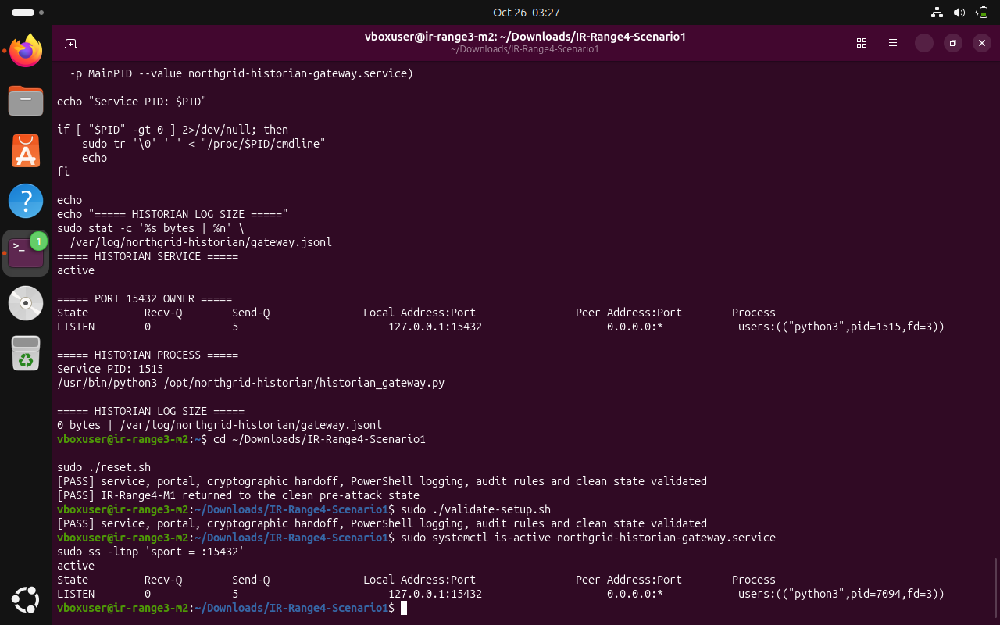
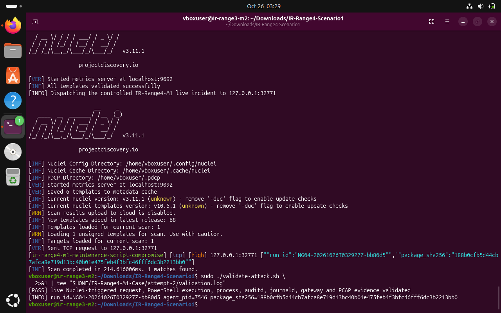
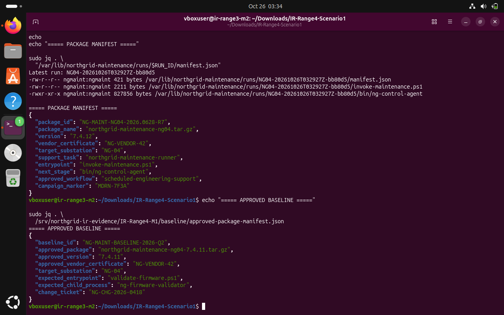
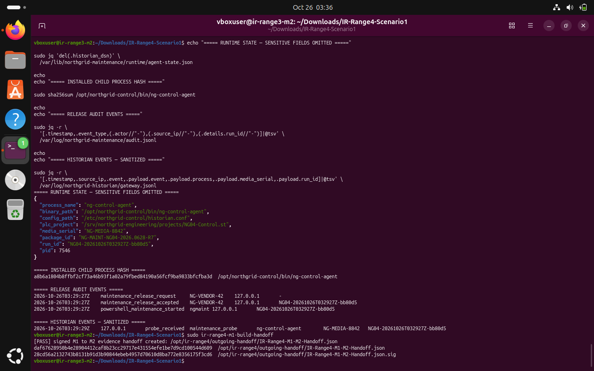
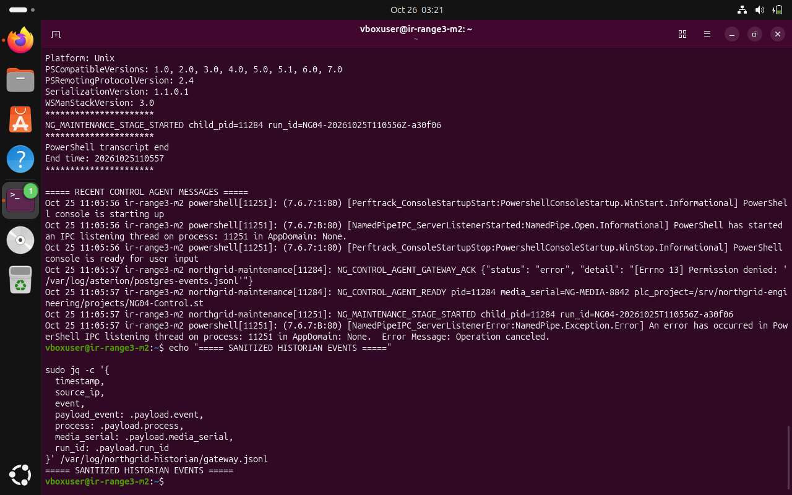

# IR Range 4 / M1 — Maintenance Script Compromise

**Case:** Silent Meridian · NorthGrid Operational Resilience  
**Scenario identifier:** `IR-Range4-M1`  
**Disposition:** Live validator passed; evidence correlated; signed M1-to-M2 handoff created.  
**Primary release run:** `NG04-20261026T032927Z-bb80d5`  
**Target service:** NorthGrid maintenance portal, TCP `32771`

## 1. Executive summary

Machine 1 examined a NorthGrid-branded maintenance release received through the prior Asterion evidence chain. The clean baseline was validated before the live, local lab incident was dispatched. The successful attack validator confirmed PowerShell execution, process telemetry, audit/journal records, historian-gateway activity and packet-capture evidence. Comparing the observed package manifest with the approved baseline identified a version and execution-chain mismatch despite the matching vendor identity.

This was a controlled training environment using localhost services. The evidence does not establish activity on any real NorthGrid system or operational substation.

## 2. Baseline and incoming trust context

The scenario's expected baseline identifies vendor `NG-VENDOR-42`, substation `NG-04`, approved version `7.4.11`, entrypoint `validate-firmware.ps1`, and child process `ng-firmware-validator`. The package present during the successful run was `NG-MAINT-NG04-2026.0628-R7`, version `7.4.12`, with entrypoint `invoke-maintenance.ps1` and next stage `bin/ng-control-agent`.

### Clean state validation

```bash
cd ~/Downloads/IR-Range4-Scenario1
sudo ./reset.sh
sudo ./validate-setup.sh
sudo ss -ltnp 'sport = :15432'
```

> **Terminal evidence — E01 · Clean baseline.** The reset and setup validator returned PASS. The screenshot also records the local historian gateway listener; a prior port-conflict diagnosis was kept separate from the final successful run.



## 3. Controlled incident and validation

The live Nuclei template dispatched the incident to the local maintenance portal. The successful run is associated with release run `NG04-20261026T032927Z-bb80d5`; the validator reported a PASS for PowerShell execution, process telemetry, audit/journal logs, gateway events and PCAP evidence.

```bash
CASE="$HOME/IR-Range4-M1-Case"
mkdir -p "$CASE/logs"
set -o pipefail
./Attack-VM/IR-Range4-M1/run-attack.sh 127.0.0.1 \
  2>&1 | tee "$CASE/logs/attack-trigger.log"
sudo ./validate-attack.sh 2>&1 | tee "$CASE/logs/validation.log"
```

> **Terminal evidence — E02 · Live incident validation.** The displayed validator passed for the final successful run and reports the release run ID and package SHA-256.



## 4. Manifest comparison and key finding

The observed manifest differed from the approved manifest in the following fields:

| Field | Approved baseline | Observed package |
|---|---|---|
| Version | `7.4.11` | `7.4.12` |
| Entrypoint | `validate-firmware.ps1` | `invoke-maintenance.ps1` |
| Expected child process | `ng-firmware-validator` | `ng-control-agent` |
| Vendor certificate identity | `NG-VENDOR-42` | `NG-VENDOR-42` |
| Target | `NG-04` | `NG-04` |

The matching vendor identity alone was insufficient to establish that the contents and workflow matched the approved baseline.

```bash
RUN_ID="NG04-20261026T032927Z-bb80d5"
sudo jq . "/var/lib/northgrid-maintenance/runs/$RUN_ID/manifest.json"
sudo jq . /srv/northgrid-ir-evidence/IR-Range4-M1/baseline/approved-package-manifest.json
```

> **Terminal evidence — E03 · Manifest comparison.** The command output shows the observed 7.4.12 package and the approved 7.4.11 baseline side by side.



## 5. Correlation and chain of custody

The release audit sequence included `maintenance_release_request`, `maintenance_release_accepted`, and `powershell_maintenance_started`. Runtime evidence identified `ng-control-agent`, package ID `NG-MAINT-NG04-2026.0628-R7`, media serial `NG-MEDIA-8842`, and engineering project `/srv/northgrid-engineering/projects/NG04-Control.st`. A `maintenance_probe` event was observed at the local historian gateway.

```bash
sudo jq -r \
  '[.timestamp,.event_type,(.actor//"-"),(.source_ip//"-"),(.details.run_id//"-")]|@tsv' \
  /var/log/northgrid-maintenance/audit.jsonl
sudo ir-range4-m1-build-handoff
```

> **Terminal evidence — E04 · Audit correlation and handoff.** The screenshot contains the release audit timeline, sanitized runtime state, historian probe, and successful signed M1-to-M2 handoff creation.



## 6. Initial non-passing attempt — kept distinct from final result

An earlier attempt returned a permission error for `/var/log/asterion/postgres-events.jsonl` and a PowerShell IPC listener error. That attempt was not treated as a successful result. The lab was returned to its clean baseline and the successful run above was independently validated. The stale path is distinct from the Range 4 historian gateway log at `/var/log/northgrid-historian/gateway.jsonl`.

> **Terminal evidence — E05 · Earlier diagnostic.** This is explicitly an earlier failed attempt. It is retained for troubleshooting transparency and is not the evidence used to claim the final validator passed.



## 7. Evidence retained and handoff

The case preserved the release request identifier, observed/approved manifest comparison, PowerShell/process evidence, audit records, gateway activity and packet capture. The signed output was created at `/opt/ir-range4/outgoing-handoff/IR-Range4-M1-M2-Handoff.json`; downstream M2 setup later validated this handoff.

**Containment/recovery considerations:** preserve logs and the package before changing services; revoke or rotate maintenance credentials; quarantine the mismatched release; validate the approved package hash and entrypoint; monitor engineering workstation process creation and historian access; coordinate recovery with operations before making any change affecting availability.

## 8. Limitations

These screenshots demonstrate the lab's local validator and telemetry. They do not establish a real-world substation compromise. The initial diagnostic is included to explain the retry path and is not counted as the final successful attempt.
