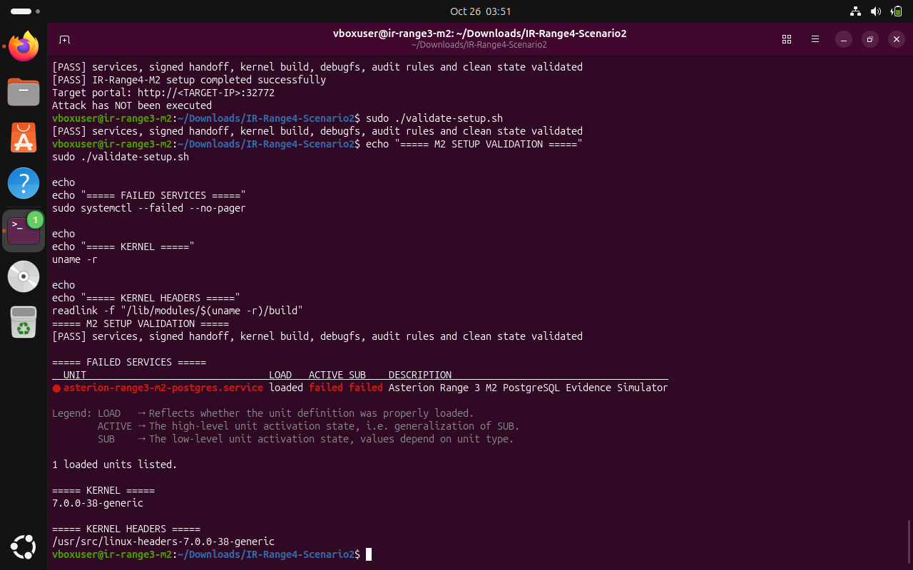
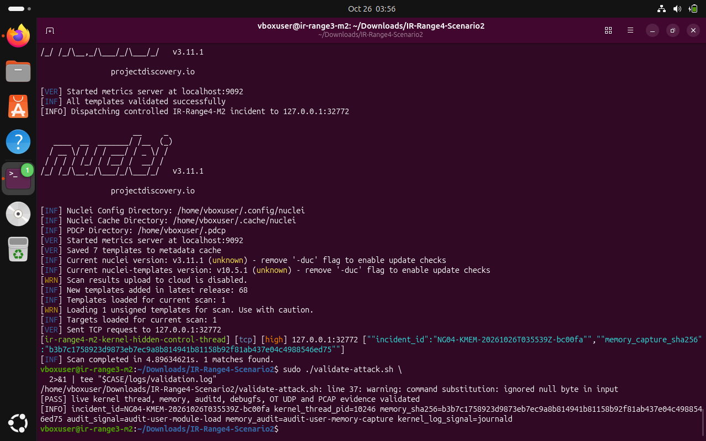
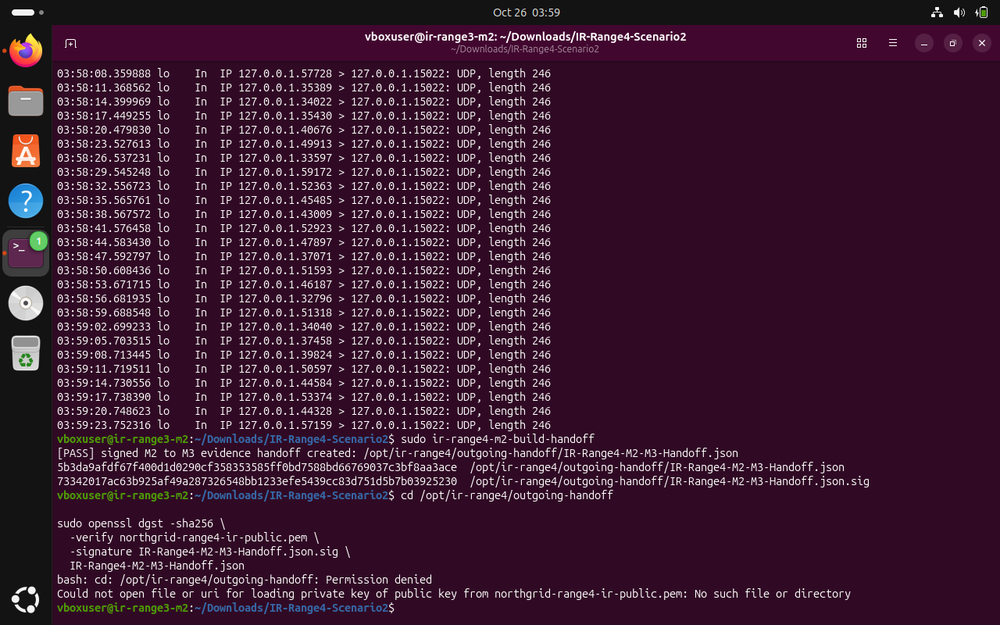
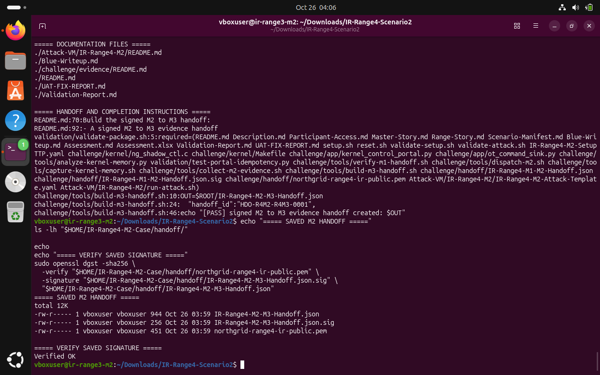

# IR Range 4 / M2 — Kernel-Hidden Control Thread

**Scenario identifier:** `IR-Range4-M2`  
**Disposition:** Live attack validator passed; evidence collection integrity checked; signed M2-to-M3 handoff created and verified.  
**Incident ID:** `NG04-KMEM-20261026T035539Z-bc00fa`  
**Reported kernel-thread PID:** `10246`  
**Portal:** localhost TCP `32772` · **OT sink:** localhost UDP `15022`

## 1. Executive summary

Machine 2 continued the signed M1 chain. The scenario asks responders to explain control traffic that continues after the visible user-space `ng-control-agent` stage is gone. The controlled training module creates a real kernel worker and a detached forensic control record for memory and telemetry analysis. The attack validator passed for the live kernel thread, memory capture, debugfs, audit evidence, OT UDP and PCAP. The signed M2-to-M3 handoff was subsequently generated and its signature verified.

This is a dedicated lab scenario; it did not contact an external OT device or a physical PLC.

## 2. Baseline and platform notes

The M2 setup validator reported the services, signed handoff, kernel build, debugfs, audit rules and clean state validated. The captured environment showed kernel `7.0.0-38-generic` and matching headers at `/usr/src/linux-headers-7.0.0-38-generic`. The scenario package's stated validated profile is Ubuntu Server 22.04 x86-64; this recorded run used the user's newer Ubuntu environment. The observed successful build and validator pass are documented, but the OS-version difference remains a reproducibility caveat. A separate failed `asterion-range3-m2-postgres.service` appears to be a legacy Range 3 unit and is not presented as an M2 service failure.

```bash
cd ~/Downloads/IR-Range4-Scenario2
sudo ./validate-setup.sh
uname -r
readlink -f "/lib/modules/$(uname -r)/build"
```

> **Terminal evidence — E01 · M2 clean baseline.** The M2 setup validator passed and the screenshot records the kernel and matching header path.



## 3. Controlled incident and validation

The supplied Nuclei template activated the local M2 portal. The validator reported the kernel thread, memory evidence, audit/debugfs evidence and OT UDP/PCAP evidence. The warning about a null byte was emitted during validation, but the validator still returned PASS.

```bash
CASE="$HOME/IR-Range4-M2-Case"
mkdir -p "$CASE/logs"
set -o pipefail
./Attack-VM/IR-Range4-M2/run-attack.sh 127.0.0.1 \
  2>&1 | tee "$CASE/logs/attack-trigger.log"
sudo ./validate-attack.sh 2>&1 | tee "$CASE/logs/validation.log"
```

> **Terminal evidence — E02 · Live M2 validation.** The validator confirms the controlled incident and reports incident ID `NG04-KMEM-20261026T035539Z-bc00fa`, PID `10246`, and memory-capture hash metadata.



## 4. Correlate kernel and OT evidence

The scenario package documents `ng_shadow_ctl.ko`, the kernel worker `kworker/u8:7`, root-only debugfs evidence, the memory capture, audit records and UDP messages to `127.0.0.1:15022`. The lab evidence includes a PCAP for TCP/32772 and UDP/15022. The package's training module is intended to provide a genuine kernel thread and volatile evidence record without global task-list manipulation or syscall hooking.

Representative analysis commands documented by the package:

```bash
sudo lsmod | grep ng_shadow_ctl
sudo cat /sys/kernel/debug/ng_shadow_ctl/status
sudo sha256sum -c \
  /var/lib/northgrid-kernel/memory/IR-Range4-M2-kernel-memory.bin.sha256
sudo tcpdump -nn -r \
  /var/log/northgrid-kernel/pcap/IR-Range4-M2-live.pcap \
  'tcp port 32772 or udp port 15022'
```

The captured validation output is the direct evidence for the successful run; the commands above describe the investigation checks.

## 5. Evidence collection and M2-to-M3 handoff

The evidence collector reported file-level collection results including the incoming M1 handoff, kernel memory capture and sidecar hash, memory analysis, audit records, kernel journal, live debugfs status, OT sink logs, UDP socket inventory and PCAP. The M2-to-M3 handoff builder reported success at `/opt/ir-range4/outgoing-handoff/IR-Range4-M2-M3-Handoff.json`; cryptographic verification returned `Verified OK`. The saved copies were kept in `~/IR-Range4-M2-Case/handoff/`.

```bash
sudo ir-range4-m2-collect-evidence
sudo ir-range4-m2-build-handoff
sudo openssl dgst -sha256 \
  -verify /opt/ir-range4/outgoing-handoff/northgrid-range4-ir-public.pem \
  -signature /opt/ir-range4/outgoing-handoff/IR-Range4-M2-M3-Handoff.json.sig \
  /opt/ir-range4/outgoing-handoff/IR-Range4-M2-M3-Handoff.json
```

> **Terminal evidence — E03 · Handoff build.** The terminal shows the M2-to-M3 handoff generation and a successful signature verification using absolute paths.


> **Terminal evidence — E04 · Preserved handoff.** The saved handoff, signature and public key are present in the private case folder; the saved signature verifies successfully.



## 6. Operational lessons

Preserve volatile memory and debugfs output before unloading the module or resetting the VM. Correlate the module-load record, kernel thread PID/name, detached control record, command buffer and OT sink network record; no single artifact alone is sufficient. Retain the handoff only in controlled case storage and exclude the raw memory dump and internal operational artifacts from a public GitHub repository.

## 7. Completion caveat

This package did not include a root-level `validate-completion.sh`. The documented completion path was the live attack validator, evidence collector, M2-to-M3 handoff builder and cryptographic signature verification. The nonexistent script is not treated as a failing validation check.
