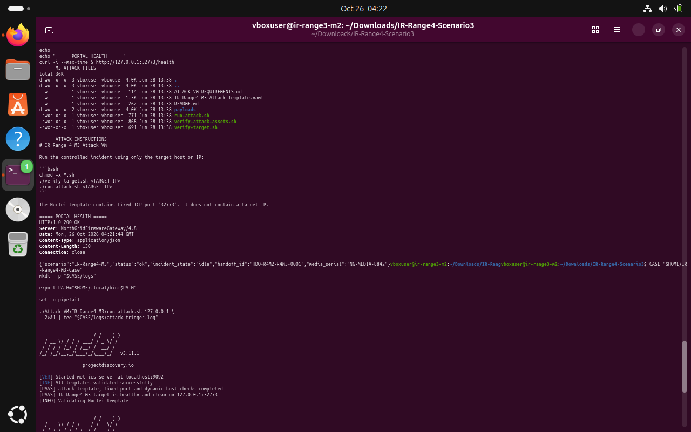
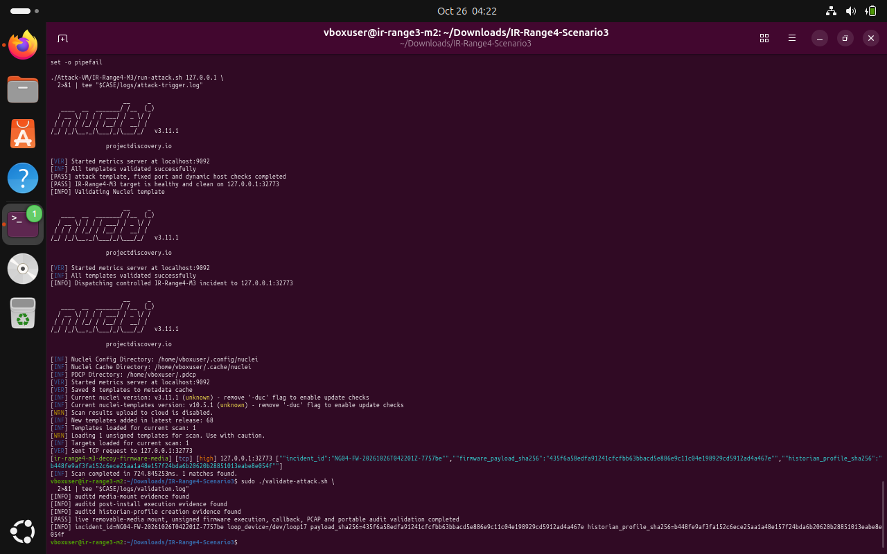
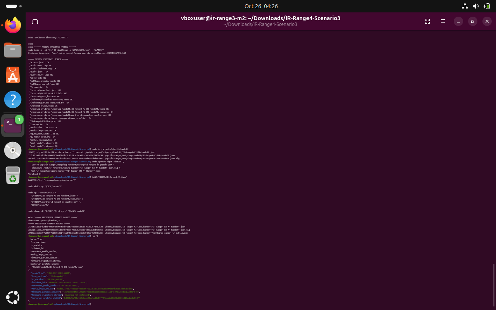

# IR Range 4 / M3 — Decoy Firmware Media

**Scenario identifier:** `IR-Range4-M3`  
**Disposition:** Attack validator passed; evidence manifest checked; signed M3-to-M4 handoff generated and verified.  
**Incident ID:** `NG04-FW-20261026T042201Z-7757be`  
**Portal:** localhost TCP `32773`  
**Media serial:** `NG-MEDIA-8842`

## 1. Executive summary

Machine 3 investigated removable-media activity handed forward from M2. The clean setup produced a detached FAT16 firmware-media image and verified the signed M2-to-M3 handoff. The controlled incident validator reported the media-mount evidence, post-install execution evidence, historian-profile creation evidence, callback, packet capture and portable audit validation as complete. Evidence hashes were checked and the signed M3-to-M4 handoff was generated.

A notable finding passed forward was `firmware_signature_status: missing-not-enforced`. This describes the firmware package's signature enforcement state; it does not mean the signed M3-to-M4 handoff itself failed signature verification.

## 2. Clean baseline and incoming handoff

The M3 portal was available at `127.0.0.1:32773`. The package's final setup validator confirmed the clean state and built the detached FAT16 image. The incoming M2 handoff was verified against the provided public key before the controlled incident.

```bash
cd ~/Downloads/IR-Range4-Scenario3
sudo ./validate-setup.sh
curl -fsS http://127.0.0.1:32773/health | jq .
```

> **Terminal evidence — E01 · Portal and attack assets.** The local portal health, attack instructions and fixed local target port are visible in the terminal capture.



## 3. Controlled incident and validation

The controlled M3 dispatch produced incident `NG04-FW-20261026T042201Z-7757be`. The validator reported that the live removable-media mount, unsigned firmware execution, callback, PCAP and portable audit validation had completed. It also detected auditd media-mount, post-install execution and historian-profile creation evidence.

```bash
CASE="$HOME/IR-Range4-M3-Case"
mkdir -p "$CASE/logs"
set -o pipefail
./Attack-VM/IR-Range4-M3/run-attack.sh 127.0.0.1 \
  2>&1 | tee "$CASE/logs/attack-trigger.log"
sudo ./validate-attack.sh 2>&1 | tee "$CASE/logs/validation.log"
```

> **Terminal evidence — E02 · Live incident validation.** The validator passed and reports the incident identifier, firmware-payload hash and historian-profile hash.



## 4. Findings and evidence preservation

The case collection included the detached media image and manifest, incoming M2 handoff, media mount/portal/audit logs, callback telemetry, PCAP, service journals and incident state. SHA-256 verification reported `OK` for the collected file manifest. The evidence collector's output directory was timestamped under `/var/lib/northgrid-firmware/evidence-collection/` (the run shown in the terminal used `20261026T042412Z`).

```bash
sudo ir-range4-m3-collect-evidence
# Use the exact directory returned by the collector:
EVIDENCE_DIR="/var/lib/northgrid-firmware/evidence-collection/20261026T042412Z"
sudo bash -c 'cd "$1" && sha256sum -c SHA256SUMS.txt' _ "$EVIDENCE_DIR"
```

> **Terminal evidence — E03 · Evidence and handoff integrity.** The captured terminal shows a file-by-file evidence hash pass and the signed M3-to-M4 handoff creation/verification workflow.



## 5. M3-to-M4 handoff

The signed handoff was created at `/opt/ir-range4/outgoing-handoff/IR-Range4-M3-M4-Handoff.json`. The saved copy was preserved under `~/IR-Range4-M3-Case/handoff/`. The main continuity fields included:

| Field | Value |
|---|---|
| `handoff_id` | `HDO-R4M3-R4M4-0001` |
| `from_machine` → `to_machine` | `IR-Range4-M3` → `IR-Range4-M4` |
| Incident | `NG04-FW-20261026T042201Z-7757be` |
| Campaign marker | `MDRN-7F3A` |
| Media serial | `NG-MEDIA-8842` |
| Firmware signature status | `missing-not-enforced` |

The handoff signature was verified successfully. This supports continuity into M4's database-focused investigation.

## 6. Response considerations

Preserve the original image, manifest, timestamp, mount records and hash results before rebuilding or remounting the media. Quarantine the untrusted firmware package, check the approved firmware signature workflow, compare its payload hash with an approved release, and inspect post-install behavior and historian-profile changes. Because this was a lab emulation, it does not establish that a real removable device or controller was affected.
