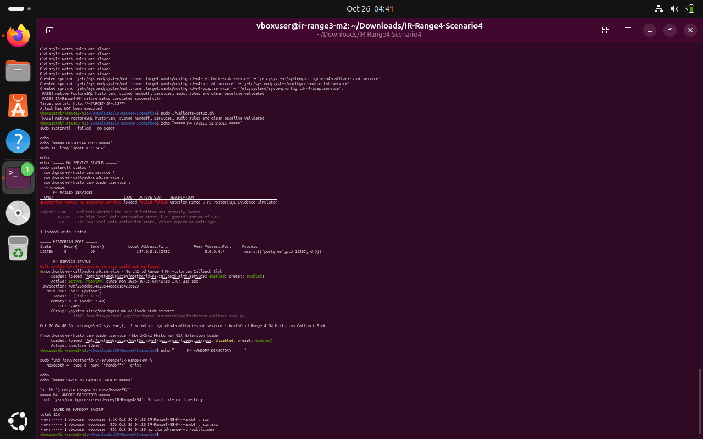
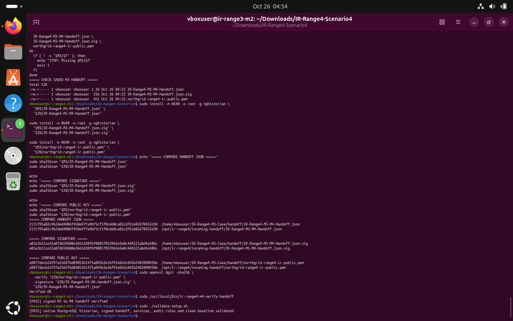
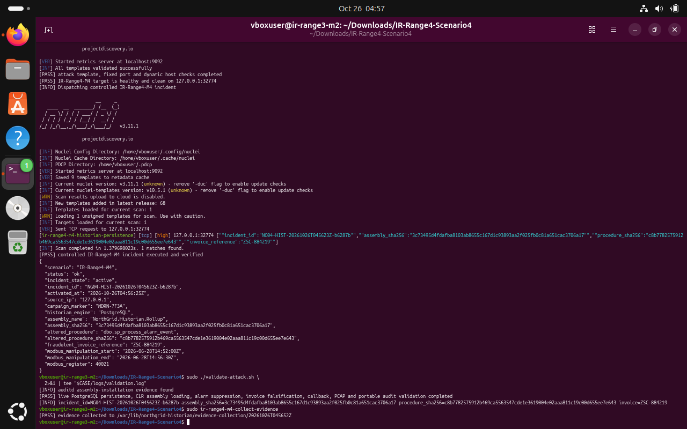
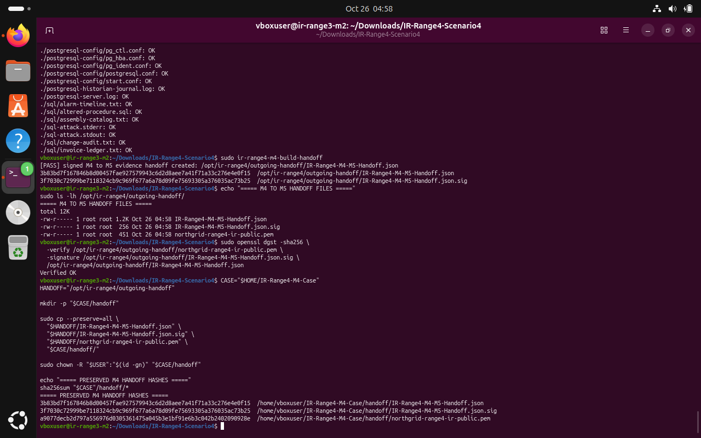

# IR Range 4 / M4 — Historian Persistence

**Scenario identifier:** `IR-Range4-M4`  
**Disposition:** Live validator passed; evidence collection completed; collected evidence hashes checked; signed M4-to-M5 handoff created and verified.  
**Incident ID:** `NG04-HIST-20261026T045623Z-b6287b`  
**Portal:** localhost TCP `32774` · **PostgreSQL historian:** localhost TCP `15432`

## 1. Executive summary

Machine 4 investigated database persistence after the decoy firmware-media incident. The controlled incident validator passed for PostgreSQL persistence, CLR assembly loading, alarm suppression, invoice falsification, callback telemetry, PCAP and portable audit evidence. The case recorded an assembly named `NorthGrid.Historian.Rollup`, an altered `dbo.sp_process_alarm_event` procedure, fraudulent invoice reference `ZSC-884219`, and Modbus register `40021` for correlation into M5.

All database changes described here were in the isolated PostgreSQL lab service; this report does not claim that any real historian or invoice system was changed.

## 2. Clean baseline and real M3 handoff

The package validator passed for the native PostgreSQL historian, handoff, services, audit rules and clean baseline. The actual M3-to-M4 handoff from `~/IR-Range4-M3-Case/handoff/` was installed into `/opt/ir-range4/incoming-handoff/`. The expected system group was `nghistorian`; an earlier attempt using the nonexistent group `historian` failed, so it was corrected using the package's actual account/group and then reverified.

```bash
M3="$HOME/IR-Range4-M3-Case/handoff"
IN="/opt/ir-range4/incoming-handoff"
sudo install -m 0640 -o root -g nghistorian \
  "$M3/IR-Range4-M3-M4-Handoff.json" "$IN/IR-Range4-M3-M4-Handoff.json"
sudo install -m 0640 -o root -g nghistorian \
  "$M3/IR-Range4-M3-M4-Handoff.json.sig" "$IN/IR-Range4-M3-M4-Handoff.json.sig"
sudo install -m 0640 -o root -g nghistorian \
  "$M3/northgrid-range4-ir-public.pem" "$IN/northgrid-range4-ir-public.pem"
sudo /usr/local/bin/ir-range4-m4-verify-handoff
sudo ./validate-setup.sh
```

> **Terminal evidence — E01 · Clean M4 baseline.** The native PostgreSQL baseline validated. The screenshot notes a legacy Range 3 service in `systemctl --failed`; M4 service and setup validation results are shown separately.


> **Terminal evidence — E02 · Actual M3 handoff installed.** The three actual M3 handoff files match their preserved copies; the OpenSSL signature and M4-specific verifier both pass.



## 3. Controlled M4 incident

The incident state recorded the following high-value indicators:

| Indicator | Recorded value |
|---|---|
| Assembly | `NorthGrid.Historian.Rollup` |
| Altered procedure | `dbo.sp_process_alarm_event` |
| Fraudulent invoice reference | `ZSC-884219` |
| Related Modbus register | `40021` |
| Manipulation window | `2026-06-28T14:52:00Z` to `2026-06-28T14:56:30Z` |
| Campaign marker | `MDRN-7F3A` |

The validator reported evidence for assembly installation, altered database logic, suppressed alarms, invoice falsification, callback and PCAP activity. The database persistence and event manipulation were correlated through the timeline and audit logs.

```bash
CASE="$HOME/IR-Range4-M4-Case"
mkdir -p "$CASE/logs"
set -o pipefail
./Attack-VM/IR-Range4-M4/run-attack.sh 127.0.0.1 \
  2>&1 | tee "$CASE/logs/attack-trigger.log"
sudo ./validate-attack.sh 2>&1 | tee "$CASE/logs/validation.log"
```

> **Terminal evidence — E03 · Live M4 validator.** The incident record and validator output show the database, CLR assembly, alarm suppression, invoice, callback, PCAP and audit checks passing.



## 4. Evidence collection and integrity

The evidence collector saved a timestamped collection under `/var/lib/northgrid-historian/evidence-collection/20261026T045652Z`. The collection included PostgreSQL configuration, database dump/control data, SQL attack/audit artifacts, historian and portal logs, service journals, PCAP, incident state and incoming handoff. The SHA-256 manifest was checked file-by-file.

```bash
LATEST="/var/lib/northgrid-historian/evidence-collection/20261026T045652Z"
sudo ir-range4-m4-collect-evidence
sudo bash -c 'cd "$1" && sha256sum -c SHA256SUMS.txt' _ "$LATEST"
```

## 5. Signed M4-to-M5 handoff

The handoff builder reported success at `/opt/ir-range4/outgoing-handoff/IR-Range4-M4-M5-Handoff.json`. The OpenSSL signature check returned `Verified OK`, and the JSON/signature/public key were preserved in `~/IR-Range4-M4-Case/handoff/` before starting M5.

```bash
sudo ir-range4-m4-build-handoff
sudo openssl dgst -sha256 \
  -verify /opt/ir-range4/outgoing-handoff/northgrid-range4-ir-public.pem \
  -signature /opt/ir-range4/outgoing-handoff/IR-Range4-M4-M5-Handoff.json.sig \
  /opt/ir-range4/outgoing-handoff/IR-Range4-M4-M5-Handoff.json
```

> **Terminal evidence — E04 · Evidence and signed handoff.** The screenshot shows evidence-manifest entries reporting OK, the handoff builder, `Verified OK`, and saved handoff hashes.



## 6. Eradication and recovery considerations

After preserving evidence, remove the unauthorized extension and startup hook, restore the trusted database baseline, rotate relevant credentials, validate sensor-to-ledger integrity, and monitor the queue and historian telemetry before service restoration. Recovery should be coordinated with the process owner because historian data integrity and safety decisions can affect downstream operational response.

## 7. Scope note

M4 reported native PostgreSQL on TCP/15432, matching the lab manifest. A legacy `asterion-range3-m2-postgres.service` was visible in the user's VM but was not part of M4's passing service validator; it is documented as a separate legacy unit rather than merged into the incident chain.
