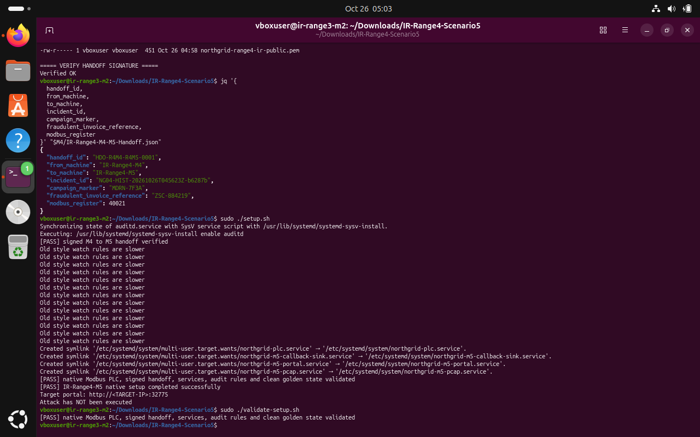
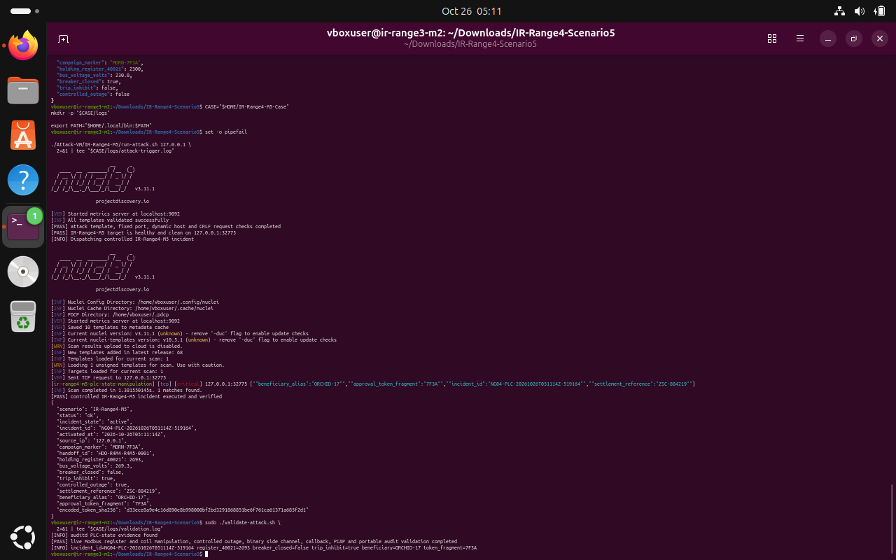
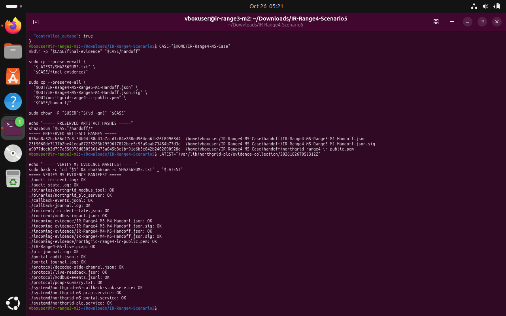
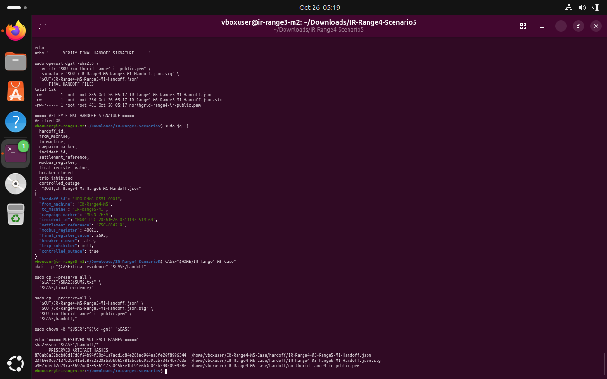

# IR Range 4 / M5 — PLC State Manipulation

**Scenario identifier:** `IR-Range4-M5`  
**Disposition:** Clean setup passed; live attack validator passed; evidence hashes verified; signed final Range 5 handoff created and verified.  
**Incident ID:** `NG04-PLC-20261026T051114Z-519164`  
**Portal:** localhost TCP `32775` · **Modbus simulator:** localhost TCP `1502`

## 1. Executive summary

Machine 5 closes the NorthGrid response chain. The controlled validator confirmed PLC-state evidence, Modbus register/coil manipulation, simulated outage, binary side channel, callback telemetry, PCAP and portable audit records. The evidence was collected to `/var/lib/northgrid-plc/evidence-collection/20261026T051312Z`; the SHA256 manifest was later verified from the correct collection directory and every listed entry returned `OK`.

The final signed handoff was generated at `/opt/ir-range4/outgoing-handoff/IR-Range4-M5-Range5-M1-Handoff.json` and its signature verified successfully.

## 2. Clean baseline and incoming handoff

M5's clean-state setup validator passed for the native Modbus PLC, signed handoff, services, audit rules and golden state. The actual M4-to-M5 JSON, signature and public key were copied from the saved M4 handoff and installed using the package's `ngplc` group. Pairwise file comparisons passed, OpenSSL returned `Verified OK`, and the M5-specific handoff verifier returned `[PASS] signed M4 to M5 handoff verified`.

The expected clean PLC state in the package is holding register `40021 = 2300` (230.0 V), breaker coil `00001` closed, trip-inhibit coil `00002 = false`, and incident state idle.

```bash
M4="$HOME/IR-Range4-M4-Case/handoff"
IN="/opt/ir-range4/incoming-handoff"
sudo install -m 0640 -o root -g ngplc \
  "$M4/IR-Range4-M4-M5-Handoff.json" "$IN/IR-Range4-M4-M5-Handoff.json"
sudo install -m 0640 -o root -g ngplc \
  "$M4/IR-Range4-M4-M5-Handoff.json.sig" "$IN/IR-Range4-M4-M5-Handoff.json.sig"
sudo install -m 0640 -o root -g ngplc \
  "$M4/northgrid-range4-ir-public.pem" "$IN/northgrid-range4-ir-public.pem"
sudo /usr/local/bin/ir-range4-m5-verify-handoff
sudo ./validate-setup.sh
```

> **Terminal evidence — E01 · Clean baseline and handoff.** The actual M4-to-M5 handoff signature verified; M5 setup and its clean golden-state validator passed.



## 3. Controlled PLC-state incident

The successful incident validator recorded:

| Field | Observed value |
|---|---|
| Incident ID | `NG04-PLC-20261026T051114Z-519164` |
| Campaign marker | `MDRN-7F3A` |
| Settlement reference | `ZSC-884219` |
| Beneficiary alias | `ORCHID-17` |
| Approval token fragment | `7F3A` |
| Holding register | `40021` |
| Final raw register value | `2693` |
| Breaker closed | `false` |
| Controlled outage | `true` |

The incident status displayed `trip_inhibit: true`. These are simulated PLC-state changes in the local Modbus server, not evidence of a physical outage.

```bash
CASE="$HOME/IR-Range4-M5-Case"
mkdir -p "$CASE/logs"
set -o pipefail
./Attack-VM/IR-Range4-M5/run-attack.sh 127.0.0.1 \
  2>&1 | tee "$CASE/logs/attack-trigger.log"
sudo ./validate-attack.sh 2>&1 | tee "$CASE/logs/validation.log"
```

> **Terminal evidence — E02 · Live M5 validation.** The validator passed for Modbus register/coil manipulation, controlled outage, side-channel, callback, PCAP and portable audit evidence.



## 4. Evidence collection and SHA-256 verification

The collector returned `[PASS] evidence collected to /var/lib/northgrid-plc/evidence-collection/20261026T051312Z`. The evidence set included the live Modbus PCAP, protocol write log, decoded side-channel token, live PLC readback, callback telemetry, auditd records, systemd journals, compiled binaries, incident state and signed incoming M4 handoff.

```bash
sudo ir-range4-m5-collect-evidence
LATEST="/var/lib/northgrid-plc/evidence-collection/20261026T051312Z"
sudo bash -c 'cd "$1" && sha256sum -c SHA256SUMS.txt' _ "$LATEST"
```

> **Terminal evidence — E03 · Evidence manifest verified.** The terminal shows the corrected verification invocation; evidence entries across audit, binaries, callback, incident, PCAP, PLC and portal files report OK.



## 5. Decoded side channel and final handoff

The package's documented decoder interprets the rapid coil sequence as `ZSC884219|ORCHID-17|7F3A`, which maps to settlement reference `ZSC-884219`, beneficiary alias `ORCHID-17` and approval token fragment `7F3A`. The final handoff fields included register `40021`, final register value `2693`, `breaker_closed: false`, and `controlled_outage: true`.

The handoff ID was `HDO-R4M5-R5M1-0001`, from `IR-Range4-M5` to `IR-Range5-M1`. The signature check returned `Verified OK`, and the JSON, signature and public key were copied into `~/IR-Range4-M5-Case/handoff/`.

```bash
sudo ir-range4-m5-build-handoff
sudo openssl dgst -sha256 \
  -verify /opt/ir-range4/outgoing-handoff/northgrid-range4-ir-public.pem \
  -signature /opt/ir-range4/outgoing-handoff/IR-Range4-M5-Range5-M1-Handoff.json.sig \
  /opt/ir-range4/outgoing-handoff/IR-Range4-M5-Range5-M1-Handoff.json
sudo jq '{handoff_id,from_machine,to_machine,campaign_marker,incident_id,settlement_reference,modbus_register,final_register_value,breaker_closed,trip_inhibited,controlled_outage}' \
  /opt/ir-range4/outgoing-handoff/IR-Range4-M5-Range5-M1-Handoff.json
```

> **Terminal evidence — E04 · Final signed handoff.** The signature returned `Verified OK`; the report captures final register/outage state and the preserved artifact hashes.



## 6. Handoff data-quality note

The live incident state reported `trip_inhibit: true`, while the final handoff JSON shown in the terminal displayed `trip_inhibited: null`. This field discrepancy should be included in the receiving team's validation checklist rather than silently reconciled. The final handoff confirms the register value and controlled-outage state, but the null field does not independently confirm the trip-inhibit value.

## 7. Recovery considerations

After preserving evidence and generating the handoff, isolate engineering access to the maintenance portal, prevent unapproved Modbus writes, confirm the actual process state with the operations owner, restore the golden register/coil values only under approved change control, validate safety interlocks, and monitor for repeat writes. Do not treat the simulated state as a real controller state.
